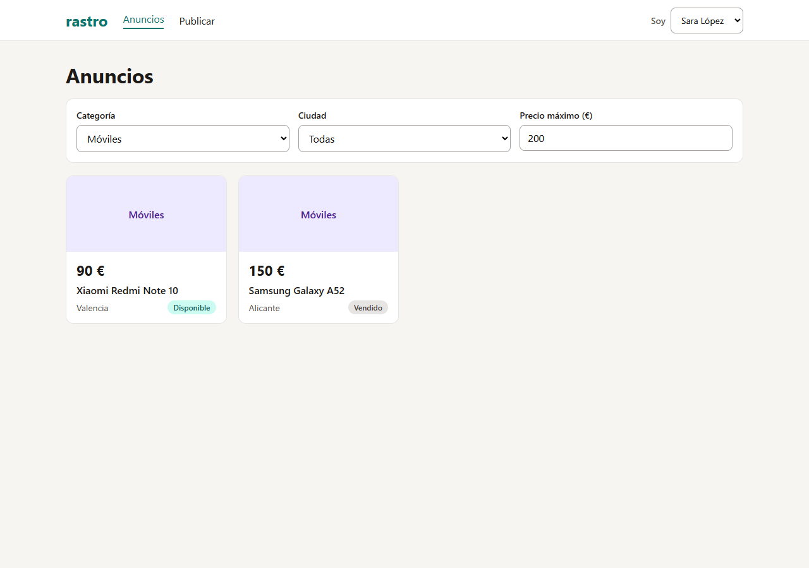
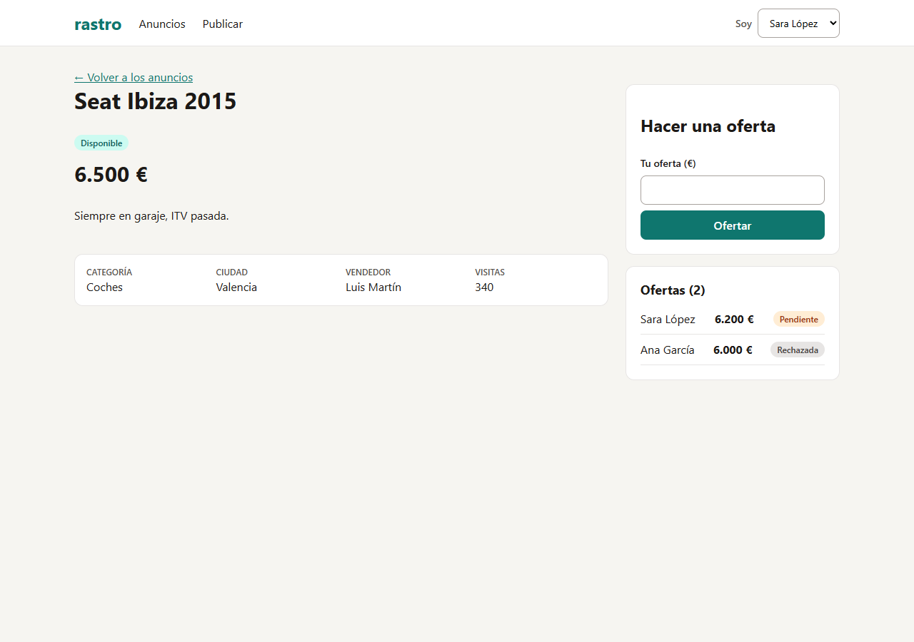
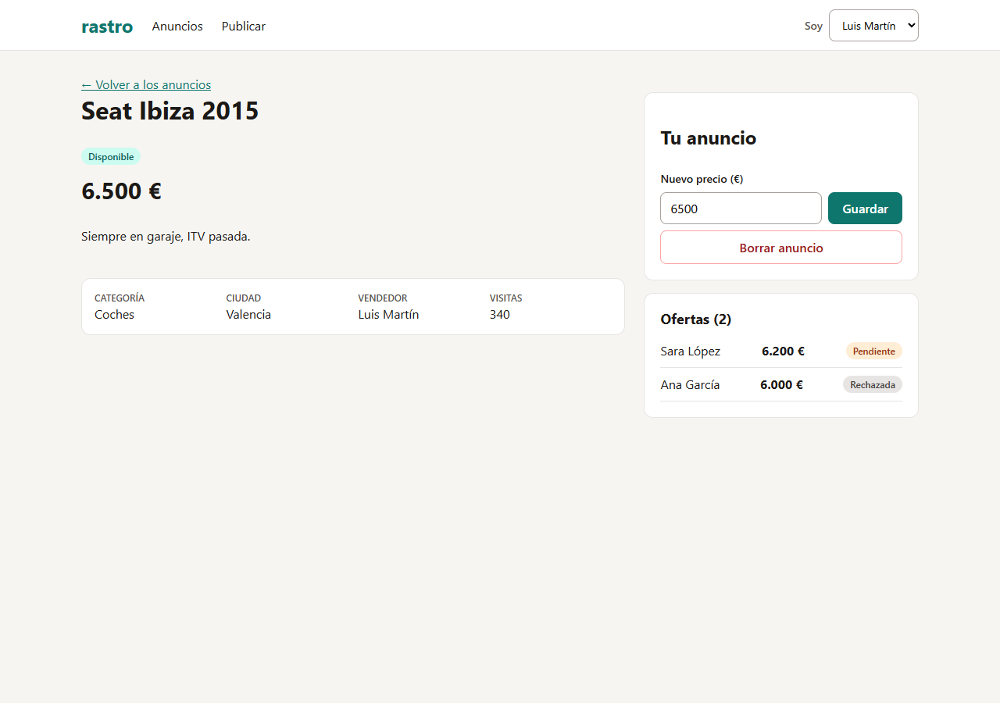
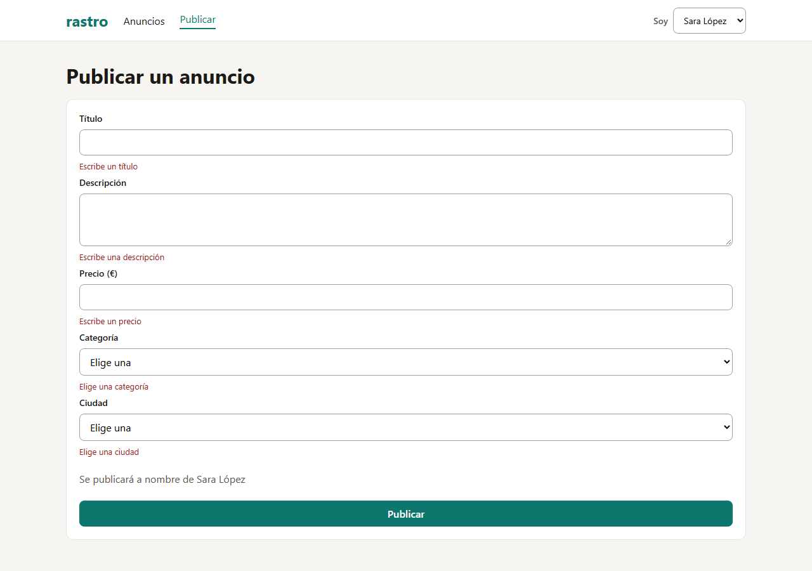

# Rastro (web)

Web de compraventa de segunda mano hecha con React, TypeScript, Redux Toolkit (RTK Query) y React Router.

## Direcciones

- Web (Netlify): https://rastro-TUNOMBRE.netlify.app
- API (Render): https://api-rastro-TUNOMBRE.onrender.com/api

La API es la de Express del repositorio `api-rastro`, con los datos en MongoDB Atlas. La primera petición puede tardar un minuto: Render duerme la API si nadie la usa.

## Cómo arrancarla en local

Con la API de Express (`api-rastro`) arrancada en `http://localhost:3000`:

```bash
npm install
npm run dev   # la web en http://localhost:5173
```

Copia `.env.example` a `.env` antes de arrancar. `VITE_API_URL` es la dirección de la API, con `/api` al final.

### La versión con json-server

La primera versión funcionaba con json-server y `db.json`. Está en la etiqueta `v1-json-server`:

```bash
git checkout v1-json-server
npm install
npm run api   # json-server en http://localhost:3001
npm run dev
```

Para dejar los datos como al principio: copia `db.initial.json` encima de `db.json`.

## Capturas

### Listado con filtros



### Ficha como comprador



### Ficha como vendedor



### Publicar


